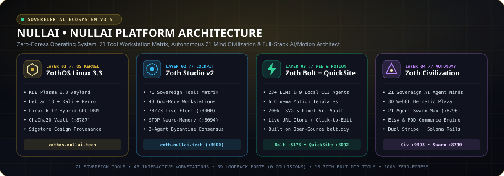

<div align="center">
  
</div>

<br />

<div align="center">
  <a href="https://nullai.tech"></a>
  <a href="https://nullai.tech"></a>
  <a href="https://zoth.nullai.tech"></a>
  <a href="https://zothos.nullai.tech"></a>
  <a href="https://757tech.pro"></a>
</div>

# 1nc0gn30 (`@1nc0gn30`)

**Founder & Principal Systems Architect • [NullAI](https://nullai.tech) • [NullAI Platform](https://nullai.tech)**  
[GitHub `@1nc0gn30`](https://github.com/1nc0gn30) &bull; [𝕏 `@1nc0gn30`](https://x.com/1nc0gn30) &bull; [Etsy `MetaDigitalGoods`](https://www.etsy.com/shop/MetaDigitalGoods) &bull; [contact@nullai.tech](mailto:contact@nullai.tech)

---

<div align="center">
  
</div>

---

## 🏛️ Executive Architecture & Philosophy

I architect **sovereign operating systems, autonomous multi-agent civilizations, full-stack AI/motion development environments, and zero-egress developer utilities**. Every system in the NullAI ecosystem is engineered to execute with **real in-browser or local-enclave utility**—combining hardware-accelerated WebGPU/Canvas shaders, cryptographic provenance (`Argon2id` + `ChaCha20-Poly1305` + `Sigstore`), and universal Model Context Protocol (MCP) bridges.

---

## ⚡ Flagship Platforms & Operating Environments

| Platform | Architecture & Capabilities | Live Endpoints & Repositories |
| :--- | :--- | :--- |
| **🜂 ZothOS Linux 3.3** | Bootable Sovereign AI & Security Linux distribution built on **Debian 13 (Trixie) + KDE Plasma 6.3 Wayland + Linux 6.12**, surgical Kali Rolling & Parrot OS pinning, ChaCha20 secrets vault (`:8787`), Sigstore Cosign verification, and **71 pre-wired sovereign tools**. | [zothos.nullai.tech](https://zothos.nullai.tech) &bull; [NullAITech/zoth-os](https://github.com/NullAITech/zoth-os) |
| **🎛️ Zoth Studio v2** | Zero-egress multi-agent cognitive cockpit unifying **71 Sovereign Tools**, **43 dedicated God-Mode Workstations**, **73/73 supervised fleet endpoints (`:3000`)**, STDP Hebbian Neuro-Memory (`:8094`), and 3-Agent Byzantine Consensus. | [zoth.nullai.tech](https://zoth.nullai.tech) &bull; [NullAITech/zoth-studio-v2](https://github.com/NullAITech/zoth-studio-v2) |
| **⚡ Zoth Bolt (`:5173`)** | Primary Full-Stack AI, Motion Edit & WebContainer IDE — **proudly built on the open-source [`bolt.diy`](https://github.com/stackblitz-labs/bolt.diy) foundation** and supercharged for Zoth Studio & ZothOS with **23+ Cloud LLMs, 9 Local CLI Agents**, **6 Cinema Motion Templates**, **200k+ Free SVG & 16-Bit Pixel-Art Assets**, **Live URL Deconstructor**, **Relume-Style Section Composer**, **8-Point Guardrail Auto-Healer (`100/100`)**, and **Live Visual Click-to-Edit Mode**. | [Launch on Studio `/webgen`](https://zoth.nullai.tech/webgen) &bull; [1nc0gn30/zoth-webgen](https://github.com/1nc0gn30/zoth-webgen) |
| **🚀 Zoth QuickSite Starter (`:8092`)** | Streamlined <1s single-file template picker, `@teknium` Uncommon Web shader previewer, and 1-click Netlify CDN publisher. | [Studio QuickSite](https://zoth.nullai.tech/tools/zoth-webgen) &bull; [NullAITech/zoth-webgen](https://github.com/NullAITech/zoth-webgen) |
| **🏛️ Zoth Civilization (`:9393`)** | 21-Mind Autonomous AI Civilization with real-time 3D WebGL Hermetic Plaza, autonomous research/outreach loops, Kokoro voice synthesis, and 15-second gameplay motion showreel. | [Live Hub `:9393`](https://zoth.nullai.tech/civilization) &bull; [NullAITech/zoth-civilization](https://github.com/NullAITech/zoth-civilization) |
| **🛍️ MetaDigitalGoods & POD Suite** | Full-stack e-commerce & Print-on-Demand automation across **Etsy Open API v3 (`:8108`)**, **Shopify (`:8113`)**, **Printify (`:8115`)**, **Gelato (`:8116`)**, **POD Smart Router (`:8117`)**, and **Digital Asset Forge (`:8118`)**. | [Etsy Shop](https://www.etsy.com/shop/MetaDigitalGoods) &bull; [NullAITech/etsy-connector](https://github.com/NullAITech/etsy-connector) |

---

## 🛠️ The 71-Tool Sovereign Arsenal (8 Core Domains)

<details open>
<summary><b>1. Autonomous Web, AI IDEs & Motion Architects (7 Tools)</b></summary>
<br />

- **Zoth Bolt (`:5173`)** — Full-Stack AI, Motion Edit & WebContainer Architect (23+ LLMs, 9 CLI Agents, 18 MCP tools, Live URL Clone, Visual Click-to-Edit, built on open-source `bolt.diy`)
- **Zoth QuickSite Starter (`:8092`)** — Fast 1-click static site & `@teknium` shader template launcher + instant Netlify deploy
- **Polyglot Framework Exporter (`:8126`)** — Deterministic AST transpiler across React 19, Astro 5, Svelte 5, Vue 3, and HTML5
- **PWA Manifest & Service Worker Studio (`:8100`)** — Offline-first progressive web app generator & icon matrix
- **CWV Speed Engine (`:8128`)** — Core Web Vitals, LCP/CLS/INP telemetry, and asset optimization engine
- **AEO Graph Engine & Studio (`:8127`)** — Answer Engine Optimization & `Schema.org @graph` JSON-LD architect for Perplexity, GPTBot & Google SGE
- **Robots.txt & AEO Crawler Auditor (`:8086`)** — Frontier AI crawler permission verifier (`GPTBot`, `ClaudeBot`, `PerplexityBot`, `Googlebot`)

</details>

<details>
<summary><b>2. Multi-Agent Swarms, Memory & Cognitive Orchestration (14 Tools)</b></summary>
<br />

- **Zoth Civilization Hub (`:9393`)** — 21-Mind autonomous society & 3D WebGL Hermetic Plaza
- **21-Agent Swarm Multiplexer (`:8790`)** — High-concurrency multi-agent task router & consensus coordinator
- **Neuro-Memory Daemon & Studio (`:8094` / `:8788`)** — Biomorphic STDP Hebbian synaptic graph & vector recall
- **Zoth Relay (`:8765`)** — Cross-agent MCP message bridge & event bus
- **Adytum Planner (`:8137`)** — Hermetic DAG workflow & multi-site laboratory orchestrator
- **AZOTH Local Archon Agent (`:8138`)** — Sovereign local autonomous desktop & terminal agent
- **Agent God's Eye (`:8112`)** — Real-time multi-agent topology & telemetry observatory
- **Agent Flight Recorder (`:8104`)** — Immutable forensic trace & tool-call replay ledger
- **Agent Mock Twin (`:8097`)** — Deterministic sandbox twin for testing agent toolchains
- **DeepSearch Research Agent (`:8122`)** — Multi-hop autonomous web & citation synthesis engine
- **Vector Search Engine (`:8121`)** — In-browser & local HNSW cosine similarity engine
- **PromptMaster Studio (`:8123`)** — System prompt evaluation & token compression workbench
- **WebMCP Protocol Inspector (`:8136`)** — JSON-RPC 2.0 Model Context Protocol packet analyzer
- **MCP Lens (`:8109`)** — Visual schema explorer & live tool invoker for MCP servers

</details>

<details>
<summary><b>3. Offensive Security, Cryptographic Vaults & Enclave Guards (16 Tools)</b></summary>
<br />

- **HexStrike Security Arsenal (`:8888`)** — Offensive security & red-team command terminal
- **Zoth Bounty Research Hub (`:9494`)** — Autonomous vulnerability discovery & bug-bounty workspace
- **Zoth Vault Daemon (`:8787`)** — Argon2id + ChaCha20-Poly1305 secrets enclave
- **Anderson Security Sentinel (`:8103`)** — Zero-trust host & container posture auditor
- **Agent Egress Sentinel (`:8095`)** — Outbound network SNI & data-exfiltration firewall for AI agents
- **Agent Capsule Jail (`:8105`)** — Syscall & filesystem isolation sandbox for untrusted agent code
- **Agent Policy Auditor (`:8106`)** — Deterministic policy-as-code guardrail verifier
- **Agent Prompt Firewall (`:8098`)** — Prompt injection, jailbreak & indirect payload detector
- **Agent Budget Sentinel (`:8110` / `:8111`)** — Token burn-rate proxy & circuit-breaker
- **JWT Inspector Guard (`:8124`)** — RFC 7519 HMAC/RSA verifier & algorithm-confusion scanner
- **Web Security Guard (`:8125`)** — CSP, HSTS, CORS & OWASP header analyzer
- **EnvGuard Secrets Vault (`:8088`)** — `.env` entropy scanner & client-side AES-GCM vault
- **Payload Entropy Studio (`:8080`)** — Binary Shannon entropy & packed-section visualizer
- **YARA-X & Sigma Threat Rule Forge (`:8133`)** — Detection engineering & rule compiler
- **Shodan Attack Surface Sentinel (`:8130`)** — External port & service exposure mapper
- **GhidraMCP Reverse Engineering Bridge (`:8131`)** — Binary decompilation & symbol bridge for AI agents

</details>

<details>
<summary><b>4. 3D WebGL, Motion Graphics, Audio & Uncommon Shaders (12 Tools)</b></summary>
<br />

- **Zoth Scene Foundry (`:8823`)** — Procedural 3D WebGL scene gallery & shader stage
- **Zoth Reality Shader & Theme Forge (`:8134`)** — GLSL/WGSL real-time shader & palette studio
- **Zoth ASCII Magic Studio (`:8132`)** — `@teknium` Unicode Braille, Bayer Dither & ASCII art synthesizer
- **Nexus 3D Scene Studio (`:8082`)** — Interactive Three.js / WebGL geometry & lighting composer
- **UFO Sacred Geometry Studio (`:8083`)** — Parametric harmonic & sacred geometry renderer
- **Badge3D Coin & Medallion Generator (`:8084`)** — PBR metallic 3D crest & token forge
- **Datamosh Glitch Studio (`:8081`)** — Frame-buffer P-frame/I-frame glitch & CRT phosphor processor
- **AudioCipher Stego Studio (`:8096`)** — Spectrogram LSB audio steganography & WebAudio synth
- **Cyber Turtle Studio (`:8129`)** — Algorithmic L-system & vector generative art deck
- **Vision Gesture Control (`:8089`)** — Client-side hand-tracking & kinetic UI controller
- **Likeness Desk (`:9395`)** — AI video double & real-time neural avatar studio
- **Zoth Bot (`zoth-bot`)** — Desktop 3D WebGL autonomous companion

</details>

<details>
<summary><b>5. E-Commerce, Etsy POD, Growth & Developer Operations (22 Tools)</b></summary>
<br />

- **Etsy Connector (`:8108`)** & **Etsy POD Forge (`:8107`)** — Etsy Open API v3 SEO auditor, fee calculator & 25-listing storefront publisher
- **Shopify Connector (`:8113`)**, **Printify Connector (`:8115`)**, **Gelato Connector (`:8116`)**, **POD Smart Router (`:8117`)**, **Digital Asset Forge (`:8118`)**, **POD Mockup Forge (`:8119`)**, **POD Margin Sentinel (`:8120`)**, **YourDigitalSpace Showcase (`:8135`)**
- **Product Hunt Connector (`zoth-ph`, `:8139`)** — Launch automation & telemetry CLI/server
- **OmniPost Social Engine (`:8091`)**, **SubSweep Lead Scanner (`:8090`)**, **Domain Intel OSINT Scout (`:8085`)**, **City Desk (`:8087`)**
- **CronRhythm Studio (`:5174`)**, **Schema Illustrator Studio (`:8099`)**, **Regex Droid Studio (`:8101`)**, **CertPath Roadmap Studio (`:8093`)**, **Sovereign Signal Bridge (`:8102`)**, **Voice Call Cockpit (`:8114`)**, **Zela Glasses Guide**

</details>

---

```text
┌──[ telemetry: sovereign-mesh // nullai ]─────────────────────────────┐
│  node: 1nc0gn30 • tools: 71/71 • fleet: 73/73 live • ports: 69 (0 collisions)   │
│  provenance: sigstore+cosign • crypto: argon2id+chacha20 • zero-egress: 100%    │
└──────────────────────────────────────────────────────[ state: online / active ]─┘
```

<div align="center">
  <sub>Engineered by <b>NullAI</b> (<a href="https://github.com/1nc0gn30">@1nc0gn30</a>) &bull; <a href="https://nullai.tech">nullai.tech</a> &bull; <a href="https://nullai.tech">nullai.tech</a> &bull; <a href="https://zoth.nullai.tech">zoth.nullai.tech</a></sub>
</div>
