<div align="center">
  
</div>

# Neal Frazier

**Founder & Systems Architect • [Neal Frazier Tech](https://nealfrazier.tech) • [NullAI Platform](https://nullai.tech)**  
Virginia Beach, VA &bull; [@1nc0gn30](https://github.com/1nc0gn30) &bull; [𝕏 @NealFrazierTech](https://x.com/NealFrazierTech) &bull; [contact@nealfrazier.tech](mailto:contact@nealfrazier.tech)

---

### ⚡ Sovereign Pro Developer Suite & Local Business Launchers

> **Founding Member Lifetime Access**: Unlock all **44 zero-dependency, 100% client-side AI, MCP, SEO & Security Studios** for a single one-time payment (**$0/mo** — use promo code `FOUNDER25` at checkout for 25% off):
> - 🏆 **[All-Access Sovereign Pro Bundle (All 44 Tools — $49 Lifetime)](https://buy.stripe.com/eVq14m5k16hW4Le0xWfw40M)**
> - 🏙️ **[City Desk: 1,000 Finished Local Trade Websites Across 50 US Cities](https://city-desk.netlify.app)** — **[Done-For-You Custom Launch + Domain ($149)](https://buy.stripe.com/9B6fZg7s96hWa5ya8wfw40O)** | **[Standalone HTML Bundle ($19)](https://buy.stripe.com/6oU7sK3bTcGk5Pia8wfw40N)**
> - 🕸️ **[AEO Knowledge Graph Engine ($19 Pro)](https://aeo-graph-engine.netlify.app)** — [Instant Stripe Unlock](https://buy.stripe.com/6oUbJ08wddKoa5y0xWfw40P)
> - ⚡ **[CWV Speed Optimization Studio ($19 Pro)](https://cwv-speed-studio.netlify.app)** — [Instant Stripe Unlock](https://buy.stripe.com/bJe00i13LbCg6Tm2G4fw40Q)
> - 🧠 **[PromptMaster Studio IDE ($19 Pro)](https://promptmaster-studio.netlify.app)** — [Instant Stripe Unlock](https://buy.stripe.com/cNiaEWaEldKo6Tm1C0fw40D)
> - 🔐 **[EnvGuard Air-Gapped Secrets Vault ($19 Pro)](https://envguard-vault.netlify.app)** — [Instant Stripe Unlock](https://buy.stripe.com/00w00i13L8q4dhK1C0fw40R)
> - 🤖 **[Robots.txt & AI Crawler Auditor ($19 Pro)](https://robots-txt-auditor.netlify.app)** — [Instant Stripe Unlock](https://buy.stripe.com/dRmdR8h2J5dS1z2cgEfw40J)
> - 🔬 **[MCP Lens JSON-RPC Inspector ($19 Pro)](https://mcp-lens.netlify.app)** — [Instant Stripe Unlock](https://buy.stripe.com/4gMfZg9AheOsdhKbcAfw40L)

---

### About

I design and build sovereign operating environments, autonomous multi-agent intelligence systems, and high-velocity digital infrastructure. My work bridges low-level systems engineering—from Linux kernel hardening and cryptographic vaults to in-browser neural workspaces and autonomous AI employees.

I believe in **radical engineering velocity, local-first utility, and cryptographic provenance**. Everything I build adheres to the zero-telemetry standard: private by default, verifiable by design, and engineered to run with real client-side utility rather than artificial cloud dependencies.

---

### Core Platforms & Flagship Repositories

| Project | Focus | Links |
| :--- | :--- | :--- |
| **[City Desk](https://city-desk.netlify.app)** | 1,000 production-ready local trade landing pages across 50 US cities × 20 high-margin trades with pre-wired `Schema.org LocalBusiness` JSON-LD & 100/100 Core Web Vitals. | [Live Directory](https://city-desk.netlify.app) &bull; [DFY Launch ($149)](https://buy.stripe.com/9B6fZg7s96hWa5ya8wfw40O) &bull; [HTML Bundle ($19)](https://buy.stripe.com/6oU7sK3bTcGk5Pia8wfw40N) |
| **[AEO Graph Engine](https://aeo-graph-engine.netlify.app)** | Answer Engine Optimization & `Schema.org` JSON-LD semantic triple generator for Perplexity, ChatGPT Search & Google SGE. | [Live App](https://aeo-graph-engine.netlify.app) &bull; [Repo](https://github.com/1nc0gn30/aeo-graph-engine) &bull; [Pro ($19)](https://buy.stripe.com/6oUbJ08wddKoa5y0xWfw40P) |
| **[CWV Speed Studio](https://cwv-speed-studio.netlify.app)** | Client-side Core Web Vitals (LCP, INP, CLS) auditor, PWA Service Worker generator & preload optimizer. | [Live App](https://cwv-speed-studio.netlify.app) &bull; [Repo](https://github.com/1nc0gn30/cwv-speed-engine) &bull; [Pro ($19)](https://buy.stripe.com/bJe00i13LbCg6Tm2G4fw40Q) |
| **[MCP Lens](https://mcp-lens.netlify.app)** | Model Context Protocol JSON-RPC 2.0 traffic inspector, tool schema validator & token footprint profiler. | [Live App](https://mcp-lens.netlify.app) &bull; [Repo](https://github.com/1nc0gn30/mcp-lens) &bull; [Pro ($19)](https://buy.stripe.com/4gMfZg9AheOsdhKbcAfw40L) |
| **[PromptMaster Studio](https://promptmaster-studio.netlify.app)** | 100% in-browser prompt AST linter, multi-model token cost profiler & system prompt compiler. | [Live App](https://promptmaster-studio.netlify.app) &bull; [Repo](https://github.com/1nc0gn30/promptmaster-studio) &bull; [Pro ($19)](https://buy.stripe.com/cNiaEWaEldKo6Tm1C0fw40D) |
| **[EnvGuard Vault](https://envguard-vault.netlify.app)** | Air-gapped WebCrypto AES-GCM-256 `.env` secret scrubber, key detector & zero-leak config manager. | [Live App](https://envguard-vault.netlify.app) &bull; [Repo](https://github.com/1nc0gn30/envguard-secrets-vault) &bull; [Pro ($19)](https://buy.stripe.com/00w00i13L8q4dhK1C0fw40R) |
| **[ZothOS](https://zothos.nullai.tech)** | Sovereign Linux distribution purpose-built for autonomous AI agents, cryptographic vault isolation, and zero-telemetry research. | [zothos.nullai.tech](https://zothos.nullai.tech) &bull; [Repo](https://github.com/1nc0gn30/zothos) &bull; [Pro ($19)](https://buy.stripe.com/fZu4gyaEleOsb9CdkIfw40K) |
| **[Zoth Studio](https://zoth.nullai.tech)** | Frontier multi-agent cognitive workspace, dynamic DAG composer, neural visualization arena, and real-time execution cockpit. | [zoth.nullai.tech](https://zoth.nullai.tech) &bull; [Repo](https://github.com/1nc0gn30/zoth-studiov3) |
| **[757 Tech Pro](https://757tech.pro)** | High-converting web architecture, local SEO engineering, and workflow automation for modern enterprises. | [757tech.pro](https://757tech.pro) &bull; [nealfrazier.tech](https://nealfrazier.tech) |

---

### Engineering Stack

- **Systems & Security**: Linux, Rust, Python, Go, C++, Cryptography (Argon2id, ChaCha20-Poly1305), Sigstore
- **Agentics & AI**: Multi-Agent Swarms, Model Context Protocol (MCP), Local LLMs (Ollama, vLLM), PyTorch
- **Web & Runtime**: TypeScript, React, Next.js, Node.js, Electron, Tailwind CSS, Netlify Edge

```text
┌──[ telemetry: sovereign-mesh ]──────────────────────────────────────────────────┐
│  node: 1nc0gn30 • apps: 44 live • city-desk: 1,000 pages • zero-leak: 100%     │
└───────────────────────────────────────────────────────[ state: online / active ]┘
```

---

<div align="center">
  <sub>Engineered by Neal Frazier Tech (<a href="https://github.com/1nc0gn30">@1nc0gn30</a>) &bull; <a href="https://nealfrazier.tech">nealfrazier.tech</a> &bull; <a href="https://nullai.tech">nullai.tech</a></sub>
</div>
