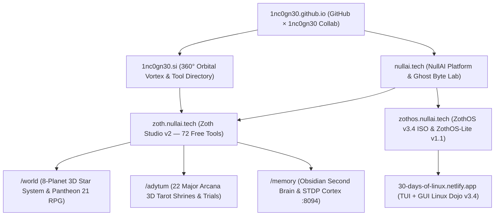

<div align="center">

```
╔══════════════════════════════════════════════════════════════════════════════╗
║ ⣿⣿⣿⣿⣿⣿⣿⣿⣿⣿⣿⣿⣿⣿⣿⣿⣿⣿⣿⣿⣿⣿⣿⣿⣿⣿⣿⣿⣿⣿⣿⣿⣿⣿⣿⣿⣿⣿⣿⣿⣿⣿⣿⣿⣿⣿⣿⣿⣿⣿⣿⣿⣿⣿⣿⣿⣿⣿⣿⣿⣿⣿⣿⣿⣿⣿⣿⣿⣿⣿ ║
║ ⣿  ░░▒▒▓▓██  1 n c 0 g n 3 0   ×   n u l l a i  ██▓▓▒▒░░  ⣿ ║
║ ⣿  S O V E R E I G N   L I N U X   ·   3 D   W E B G L   ·   A I   F L E E T  ⣿ ║
║ ⣿⣿⣿⣿⣿⣿⣿⣿⣿⣿⣿⣿⣿⣿⣿⣿⣿⣿⣿⣿⣿⣿⣿⣿⣿⣿⣿⣿⣿⣿⣿⣿⣿⣿⣿⣿⣿⣿⣿⣿⣿⣿⣿⣿⣿⣿⣿⣿⣿⣿⣿⣿⣿⣿⣿⣿⣿⣿⣿⣿⣿⣿⣿⣿⣿⣿⣿⣿⣿⣿ ║
╚══════════════════════════════════════════════════════════════════════════════╝
```

**hooded builder @ [nullai](https://nullai.tech).** local-first operating systems, 60fps unicode `U+2800` braille & bayer 8×8 dither shaders, 3D WebGL worlds, and 72 open-access developer & security tools. **100% free. zero paywalls. tips optional.**

[](https://1nc0gn30.si)
[](https://1nc0gn30.github.io)
[](https://zoth.nullai.tech)
[](https://zothos.nullai.tech)
[](https://30-days-of-linux.netlify.app)

</div>

---

## ⣿ 01 // Sovereign Ecosystem Matrix

| Surface / Platform | Live Production Portal | Source Repository | Core Architecture & Highlights |
| :--- | :--- | :--- | :--- |
| **1nc0gn30 Sovereign Hub** | **[1nc0gn30.si](https://1nc0gn30.si)** | [`1nc0gn30/nealsvision`](https://github.com/1nc0gn30/nealsvision) | **360° Orbital Turntable Vortex** (5 real-time 3D geometry modes: Merkaba Star, Quantum Torus Knot, Hyper-Icosahedron, Cyber DNA Helix, Quantum Gyroscope) + interactive 72-tool directory |
| **GitHub × 1nc0gn30 Collab** | **[1nc0gn30.github.io](https://1nc0gn30.github.io)** | [`1nc0gn30/1nc0gn30.github.io`](https://github.com/1nc0gn30/1nc0gn30.github.io) | **GitHub Dark (`#0D1117`) × Sovereign Gold (`#D4AF37`) & Emerald (`#39D353`)** with 3D WebGL + `U+2800` Braille / Bayer 8×8 Dither core & 52-week contribution matrix |
| **Zoth Studio v2** | **[zoth.nullai.tech](https://zoth.nullai.tech)** | [`NullAITech/zoth-studio-v2`](https://github.com/NullAITech/zoth-studio-v2) | **72 Open-Access Developer & Security Tools**, **8-Planet 3D Star System (`/world`)**, **Pantheon 21 Character RPG Engine**, **Adytum 22 Major Arcana 3D Tarot (`/adytum`)**, & **Second Brain (`/memory`)** |
| **ZothOS v3.4 & Lite v1.1** | **[zothos.nullai.tech](https://zothos.nullai.tech)** | [`NullAITech/zoth-os`](https://github.com/NullAITech/zoth-os) · [`zothos-lite`](https://github.com/NullAITech/zothos-lite) | **Debian 13 Trixie + KDE Plasma 6.3 Wayland Live ISO** (285+ CLIs, Kali + Parrot parity, 8 desktop rooms) + **ZothOS-Lite v1.1 A100 Web Desktop (`:8145`)** |
| **NullAI Research Lab** | **[nullai.tech](https://nullai.tech)** | [`1nc0gn30/nullai2026`](https://github.com/1nc0gn30/nullai2026) | **Ghost Byte 3D Engine**, Sovereign AI Fleet Command Deck, AEO/LLM discovery manifests (`/manifest.json`, `/llms.txt`) |
| **30 Days of Linux Dojo** | **[30-days-of-linux.netlify.app](https://30-days-of-linux.netlify.app)** | [`1nc0gn30/30-days-of-Linux-Fundamentals`](https://github.com/1nc0gn30/30-days-of-Linux-Fundamentals) | **90 Digestible Student Meals** (`Breakfast`, `Lunch`, `Dinner`), native **C Terminal TUI (`./control-panel`)** + **Astro 5 Interactive Web GUI** (`chmod`, FHS `/`, POSIX pipes `\|`) |
| **Neuro-Memory Daemon** | `127.0.0.1:8094` | [`NullAITech/neuro-memory-daemon`](https://github.com/NullAITech/neuro-memory-daemon) | **Biomorphic STDP Synaptic Cortex** (`41,690+` engrams, 21 Ring-0 MCP tools, bidirectional **Obsidian Second Brain** sync) |
| **Muse Code Linux** | `muse` CLI | [`NullAITech/muse-code-linux`](https://github.com/NullAITech/muse-code-linux) | Sovereign multi-model coding agent harness for Linux terminals |

---

## ⣿ 02 // Architecture Overview



---

## ⣿ 03 // Quick-Launch CLI (`@nullaitech/zoth`)

```bash
# Check local ZothOS & Studio loopback daemons on 127.0.0.1
npx @nullaitech/zoth status

# List all 72 open-access sovereign tools & repositories
npx @nullaitech/zoth list

# Clone & launch Zoth Studio v2 locally on http://127.0.0.1:3000
npx @nullaitech/zoth studio
```

---

## ⣿ 04 // Open-Access Ethos & Optional Patronage

Every operating system, 3D WebGL engine, Linux curriculum, and developer tool across `@1nc0gn30` and `@NullAITech` is **100% free and open-access by default** — zero paywalls, zero blur locks, and zero telemetry.

- **☕ Buy Us a Coffee (Stripe)**: [https://buy.stripe.com/3cIfZg27PdKo2D64Ocfw40X](https://buy.stripe.com/3cIfZg27PdKo2D64Ocfw40X)
- **◈ Solana Tip Address**: `GG2eQbVh8ut1BK6j1A2tz7pSySdLpD38BgyEhGcxdXoK`
- **𝕏 / Twitter**: [@1nc0gn30](https://x.com/1nc0gn30)

<sub>⣿ gold on black · unicode u+2800 braille · built in public by 1nc0gn30</sub>
